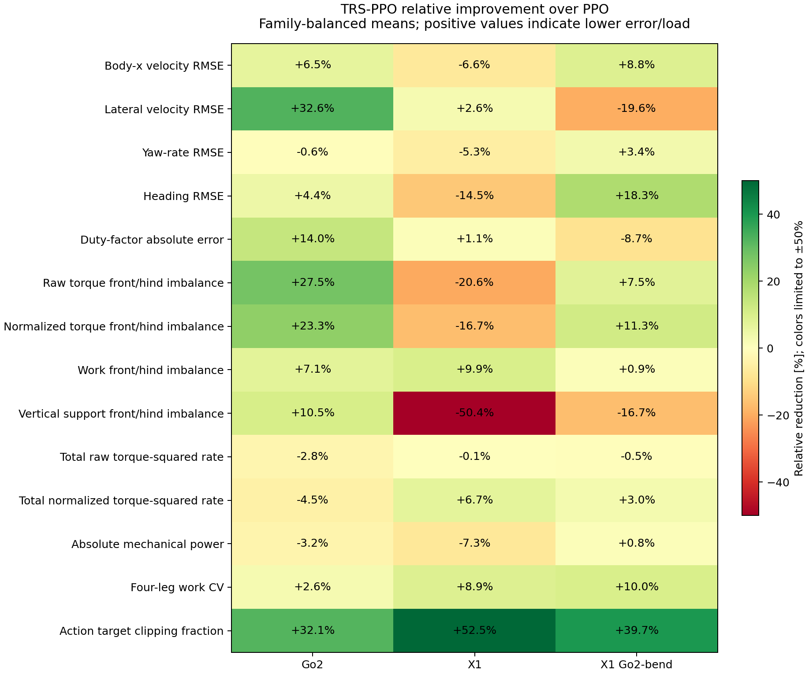
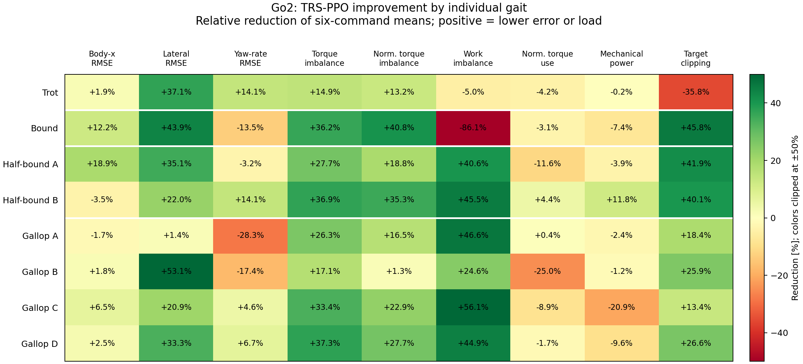
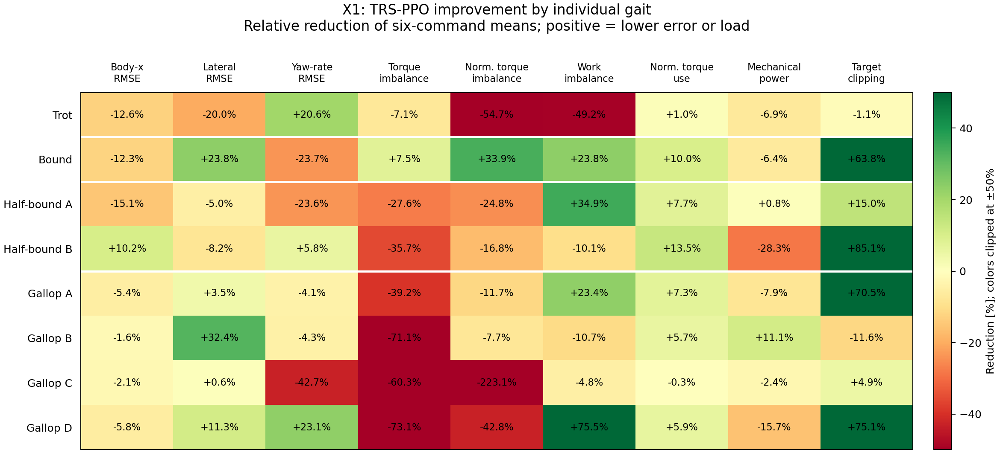
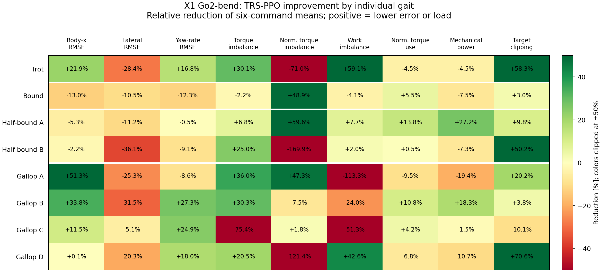
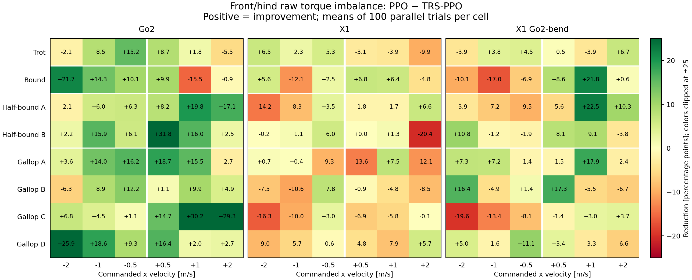
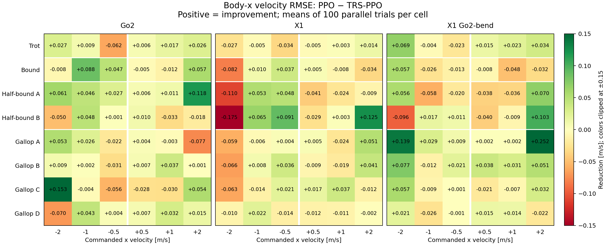

# PPO versus TRS-PPO: final-checkpoint evaluation analysis

Analysis date: 2026-10-27. PPO means the merged `*_no_trs` run; TRS-PPO means the
corresponding `*_with_trs*` run. All six checkpoints are `model_19999.pt`.
Individual-gait comparisons and five additional figures were added on 2026-10-28.

**The clearest common benefit is less joint-target clipping. The strongest
robot-specific result is better torque distribution on Go2.** X1 benefits from
lower normalized torque use, less torque saturation, and smaller impact peaks,
while its torque balance and several tracking metrics deteriorate. The Go2-bend
X1 improves some tracking and load metrics, but its results depend strongly on
direction and gait. These runs support a claim of specific benefits and
tradeoffs, rather than a general improvement in every aspect of locomotion.

**An evaluation issue affects interpretation:** the saved gait analyzer uses an
increasing clock for backward locomotion, although the controller's actual foot
phases decrease. A check of 288 representative rollout archives confirms this
mismatch. Backward gait agreement, gait-dependent success, and the saved
time-reversal alignment need correction before those scores support strong
conclusions. The velocity, torque, work, and clipping comparisons below do not
depend on that desired-contact clock.

## What improves

The following table shows **relative reductions**: positive percentages mean a
smaller error, imbalance, or load; negative percentages mean an increase. These
are family-balanced means over the complete evaluation grid. Some small changes
are sensitive to which conditions receive weight; see the interval table below.

| Metric, lower is better | Go2 | X1 | X1 Go2-bend |
|---|---:|---:|---:|
| Joint-target clipping fraction | **32.1%** | **52.5%** | **39.7%** |
| Front/hind raw torque-squared imbalance | **27.5%** | −20.6% | 7.5% |
| Front/hind normalized torque-squared imbalance | **23.3%** | −16.7% | 11.3% |
| Front/hind absolute-work imbalance | 7.1% | 9.9% | 0.9% |
| Four-leg absolute-work coefficient of variation | 2.6% | 8.9% | 10.0% |
| Front/hind vertical-support impulse imbalance | 10.5% | −50.4% | −16.7% |
| Body-x velocity RMSE | 6.5% | −6.6% | 8.8% |
| Lateral velocity RMSE | **32.6%** | 2.6% | −19.6% |
| Heading RMSE | 4.4% | −14.5% | 18.3% |
| Total normalized torque-squared rate | −4.5% | **6.7%** | 3.0% |
| Absolute mechanical power | −3.2% | −7.3% | 0.8% |



The work-balance means improve on all robots, but their condition-resampling
intervals cross zero. Thus, the shared evidence for less clipping is appreciably
stronger than the evidence for a general improvement in work balance.

## Evaluation design and comparison method

Each policy has 4,800 recorded trials: eight gait rows × six x-velocity commands
× 100 parallel environments. Commands are −2, −1, −0.5, +0.5, +1, and +2 m/s;
lateral and yaw commands are zero. Each rollout has 5 s settling and 20 s planned
measurement at a 0.02 s control step. The analyzer trims to complete gait cycles,
so rates are preferable to unadjusted exposure totals. There is one evaluation
seed, 42. All six studies have complete metric-domain coverage and zero recorded
terminations.

The gait families have different numbers of rows: trot 1, bound 1, half-bound 2,
and gallop 4. For the continuous metrics in this report, I first average the
100 trials within each of the 48 gait/velocity conditions, then average
conditions within each family, then average the four families equally. This
prevents gallop from dominating merely because it has more rows. The saved
`SCREENING_REPORT.md` and overall paired-reversal summaries often average all
trial rows directly, so their numbers can differ from this report. Success
counts below explicitly use the original 4,800-trial denominator.

Within each robot, the study manifests have identical gait libraries,
evaluation configuration, runtime overrides, inference compatibility settings,
and recorded evaluation-source provenance. Saved training environment configs
differ only in the log directory. The substantive saved PPO configuration
differences are mirror-loss enablement and coefficient 0 → 0.1. The saved
symmetry value-loss coefficient is 0.0 and data augmentation is disabled. PPO
also has resume-related configuration differences because its 20,000 iterations
were assembled from two training segments, whereas TRS-PPO was trained as one
20,000-iteration run. See [configuration differences](analysis/trs_ppo_2026-10-27/config_differences.csv).

The 100 environments do not supply 100 independent training seeds. In fact,
body-x RMSE is identical across all 100 environments in 41/48 PPO conditions and
48/48 TRS-PPO conditions for X1 Go2-bend; the corresponding counts for X1 are
30/48 and 6/48. Go2 has small trial-to-trial variation in every condition.
Consequently, I use condition-level comparisons instead of tests that treat
4,800 rows as independent algorithm replications.

The reported 95% **scenario-resampling intervals** use 10,000 paired bootstrap
replicates, resampling gait/velocity conditions within each family while keeping
the PPO/TRS-PPO pairing and equal family weights. They describe sensitivity to
condition composition. The velocities and related gait variants form a fixed,
structured grid, so these intervals are descriptive; they do not establish
statistical significance across independent training runs or unseen conditions.

## Torque distribution and leg workload

For a nonnegative front-leg exposure `F` and hind-leg exposure `H`, the primary
imbalance is `100 × |F − H| / (F + H)`. Absolute values are taken within each
trial before averaging, so front-heavy and hind-heavy trials cannot cancel.
Torque exposure integrates squared joint torque; normalized exposure integrates
`(torque / configured effort limit)²`; work integrates absolute joint power;
support exposure integrates vertical ground-reaction force. Smaller imbalance
indicates a more even front/hind distribution, independently of total effort.

| Robot | Front/hind metric | PPO | TRS-PPO | Change, percentage points |
|---|---|---:|---:|---:|
| Go2 | Raw torque squared | 29.59% | 21.44% | **−8.15** |
| Go2 | Normalized torque squared | 36.46% | 27.96% | **−8.50** |
| Go2 | Absolute work | 12.69% | 11.79% | −0.90 |
| Go2 | Vertical support impulse | 26.87% | 24.04% | −2.82 |
| X1 | Raw torque squared | 8.05% | 9.70% | +1.65 |
| X1 | Normalized torque squared | 9.24% | 10.78% | +1.54 |
| X1 | Absolute work | 10.21% | 9.20% | −1.01 |
| X1 | Vertical support impulse | 3.76% | 5.65% | +1.89 |
| X1 Go2-bend | Raw torque squared | 12.74% | 11.78% | −0.95 |
| X1 Go2-bend | Normalized torque squared | 12.72% | 11.27% | −1.44 |
| X1 Go2-bend | Absolute work | 14.01% | 13.89% | −0.13 |
| X1 Go2-bend | Vertical support impulse | 8.04% | 9.38% | +1.34 |

| Robot and metric | Conditions improved / 48 | 95% scenario interval for TRS-PPO − PPO |
|---|---:|---:|
| Go2 raw torque imbalance | **41/48** | **[−11.27, −4.82] pp** |
| Go2 normalized torque imbalance | **39/48** | **[−11.49, −5.33] pp** |
| Go2 work imbalance | 28/48 | [−4.44, +2.34] pp |
| X1 raw torque imbalance | 19/48 | [−0.50, +3.96] pp |
| X1 normalized torque imbalance | 17/48 | [−0.36, +3.52] pp |
| X1 work imbalance | 28/48 | [−3.97, +1.83] pp |
| X1 Go2-bend raw torque imbalance | 23/48 | [−4.16, +2.07] pp |
| X1 Go2-bend normalized torque imbalance | 27/48 | [−4.78, +1.93] pp |
| X1 Go2-bend work imbalance | 24/48 | [−4.94, +5.05] pp |

Go2's torque result is broad: it improves in every family, both directions, and
at all three speed magnitudes. Raw torque imbalance changes from 29.68 → 25.24%
for trot, 18.21 → 11.61% for bound, 33.47 → 22.65% for half-bound, and
36.99 → 26.26% for gallop. Work balance is less consistent: it improves for
half-bound and gallop but worsens for trot and bound.

X1 starts with much smaller torque and support imbalance than Go2. Its raw
torque imbalance worsens for trot, half-bound, and gallop, with a small
improvement for bound. Its work balance improves in three families but worsens
for trot. The change in support imbalance is a 1.89 percentage-point increase;
the 50.4% relative increase should be read in that absolute context.

For X1 Go2-bend, the modest aggregate torque benefit hides a direction tradeoff:
forward imbalance improves from 16.04 → 11.11%, while backward imbalance worsens
from 9.43 → 12.45%. This prevents a strong claim of improved load balance across
its operating conditions.

Four-leg work dispersion also decreases in the aggregate: coefficient of
variation changes from 0.1798 → 0.1752 on Go2, 0.1669 → 0.1519 on X1, and
0.2174 → 0.1956 on X1 Go2-bend. All three scenario intervals cross zero. These
are workload-distribution measurements; they do not measure fatigue life or
hardware wear directly.

## Clipping, saturation, and impacts

| Metric | Go2 PPO → TRS-PPO | X1 PPO → TRS-PPO | X1 Go2-bend PPO → TRS-PPO |
|---|---:|---:|---:|
| Joint-target clipping fraction | **1.357 → 0.921%** | **1.348 → 0.641%** | **2.858 → 1.724%** |
| Mean joint torque saturation fraction | 0.207 → 0.226% | **1.875 → 1.435%** | 1.374 → 1.139% |
| Mean joint torque utilization p95 | 0.3435 → 0.3583 | **0.5629 → 0.5373** | 0.5535 → 0.5531 |
| Largest per-foot impact-peak p95, averaged [N] | 134.7 → 140.9 | **314.1 → 242.6** | 258.5 → 308.2 |

Target clipping falls by 32.1%, 52.5%, and 39.7%, respectively. Its scenario
interval for the absolute change excludes zero on all robots: Go2
[−0.70, −0.18] pp; X1 [−1.16, −0.28] pp; X1 Go2-bend [−1.68, −0.58] pp.
This is the most consistent shared improvement in the measured results.

Target clipping and torque saturation are different quantities. The former
measures joint-position targets clipped at action limits; the latter measures
torque utilization at or above 95% of the configured effort limit. Reduced
clipping therefore does not itself demonstrate smoother actions or lower
actuator saturation.

X1 has an additional useful result: saturation decreases 23.5%, and the impact
summary decreases 22.8%. For impacts, I take each foot's 95th percentile of event
peaks, select the largest of the four feet within a trial, and then apply the
report's averaging method. This is not a pooled 95th percentile of every impact
in the study. The X1 impact-change scenario interval is [−131.0, −18.2] N.
Go2 and X1 Go2-bend do not show a corresponding reduction in that summary.

## Tracking and task performance

| Robot | Metric | PPO | TRS-PPO | Interpretation |
|---|---|---:|---:|---|
| Go2 | Body-x RMSE [m/s] | 0.2146 | 0.2007 | 6.5% lower |
| Go2 | Lateral velocity RMSE [m/s] | 0.0973 | 0.0655 | **32.6% lower** |
| Go2 | Yaw-rate RMSE [rad/s] | 0.0989 | 0.0995 | Essentially unchanged mean |
| Go2 | Heading RMSE [rad] | 1.3152 | 1.2574 | 4.4% lower |
| Go2 | Lateral position RMSE [m] | 4.9091 | 5.8357 | 18.9% higher |
| X1 | Body-x RMSE [m/s] | 0.0912 | 0.0973 | 6.6% higher |
| X1 | Lateral velocity RMSE [m/s] | 0.0559 | 0.0545 | 2.6% lower |
| X1 | Yaw-rate RMSE [rad/s] | 0.0799 | 0.0841 | 5.3% higher |
| X1 | Heading RMSE [rad] | 0.9481 | 1.0852 | 14.5% higher |
| X1 | Lateral position RMSE [m] | 4.7958 | 5.0571 | 5.4% higher |
| X1 Go2-bend | Body-x RMSE [m/s] | 0.0932 | 0.0850 | 8.8% lower |
| X1 Go2-bend | Lateral velocity RMSE [m/s] | 0.0558 | 0.0668 | 19.6% higher |
| X1 Go2-bend | Yaw-rate RMSE [rad/s] | 0.0908 | 0.0877 | 3.4% lower |
| X1 Go2-bend | Heading RMSE [rad] | 1.0954 | 0.8954 | 18.3% lower |
| X1 Go2-bend | Lateral position RMSE [m] | 5.7359 | 4.3472 | 24.2% lower |

Go2's body-x RMSE improves in 32/48 conditions and its lateral velocity RMSE in
42/48. Their scenario intervals for the change are [−0.0264, −0.0017] m/s and
[−0.0508, −0.0163] m/s. Its lateral-position error nevertheless increases:
body-frame lateral velocity, accumulated world-frame path deviation, and heading
are distinct measurements.

Speed-normalized RMSE gives a different emphasis to low-speed commands. It
changes from 0.1469 → 0.1378 on Go2, 0.0889 → 0.0878 on X1, and
0.0811 → 0.0825 on X1 Go2-bend. Thus, X1's slightly better relative error can
coexist with worse absolute RMSE, and X1 Go2-bend's aggregate absolute-RMSE
improvement does not extend to relative RMSE.

The ratio of signed world-x progress to commanded distance changes from
0.5668 → 0.5658 on Go2, 0.7431 → 0.6609 on X1, and 0.6563 → 0.7988 on
X1 Go2-bend. This measures world-x displacement, whereas velocity RMSE measures
body-frame tracking. Turns and heading drift can therefore produce low or
negative world-x progress despite reasonable body-x velocity tracking.

### Saved strict success rates

These percentages count trial rows directly, so each gait row has equal weight
and gallop represents half the trials. They use the existing evaluator's
thresholds, rather than the family weighting above.

| Robot | Velocity-only success, PPO → TRS-PPO | Saved gait-only success | Saved joint velocity + gait success |
|---|---:|---:|---:|
| Go2 | 300 → 400 / 4,800 (**6.25 → 8.33%**) | 43.19 → 41.67% | 2.08 → 2.08% |
| X1 | 600 → 1,100 / 4,800 (**12.50 → 22.92%**) | 39.44 → 39.58% | 6.25 → 8.33% |
| X1 Go2-bend | 100 → 400 / 4,800 (**2.08 → 8.33%**) | 39.58 → 33.33% | 2.08 → 2.08% |

Velocity-only success requires no termination, positive world-x progress,
relative body-x RMSE ≤ 0.20, and yaw RMSE ≤ 0.05 rad/s. TRS-PPO increases this
rate on all three robots. The yaw threshold is the binding restriction in these
data: every trial passing it also passes the other velocity-only checks.
For example, both X1 Go2-bend policies pass the relative body-x threshold in
all conditions, but few pass the yaw threshold. A higher thresholded success
rate can coexist with a slightly worse mean yaw RMSE because the error
distribution changes across conditions.

The gait-only and joint-success columns are retained for traceability, but the
backward phase-clock issue below prevents treating them as reliable evidence
for or against TRS-PPO's gait fidelity. Zero recorded terminations also offers
no evidence of a difference in termination frequency.

## Total effort and efficiency

| Robot | Total raw torque-squared rate [N²·m²], PPO → TRS-PPO | Total normalized torque-squared rate [1] | Absolute mechanical power [W] |
|---|---:|---:|---:|
| Go2 | 352.21 → 361.91 (+2.8%) | 0.4347 → 0.4545 (+4.5%) | 125.95 → 130.00 (+3.2%) |
| X1 | 540.68 → 541.28 (+0.1%) | **1.0496 → 0.9791 (−6.7%)** | 185.20 → 198.74 (+7.3%) |
| X1 Go2-bend | 625.77 → 629.02 (+0.5%) | 1.0119 → 0.9812 (−3.0%) | 207.56 → 205.83 (−0.8%) |

Better balance does not imply lower total effort. Go2 redistributes torque more
evenly while using slightly more squared torque and mechanical power. X1's
capacity-normalized torque use decreases, while absolute mechanical power
increases. The two metrics measure different aspects of actuator use.

A fair cost-per-distance comparison also needs common successful operating
conditions. Only one Go2 condition passes strict velocity success for both
policies; only two X1 conditions do; no X1 Go2-bend condition does. On those
small common subsets, work per directed metre changes from 167.35 → 144.85 J/m
for Go2 and 79.86 → 79.41 J/m for X1. The Go2 subset contains only gallop and
the X1 subset only trot. Neither supports an efficiency claim over the complete
gait grid.

Filtering merely for positive progress leaves more common conditions, but the
cost-per-metre ratio is highly sensitive to near-zero world-x progress. The
full comparison and its available families are recorded in
[common_support.csv](analysis/trs_ppo_2026-10-27/common_support.csv).
These results do not establish a general reduction in energy consumption.

## Results for each trained gait

This breakdown compares all eight trained gait rows individually, including the
two front half-bound variants and four gallop variants. Each value averages the
100 trials at each command, then weights the six signed commands equally. The
tables use **PPO → TRS-PPO**. The three overview figures show relative reductions:
green and positive values indicate improvement; red and negative values indicate
deterioration. Their colors are clipped at ±50%, but annotations retain the full
value. Large relative changes should be read alongside the absolute values.

The [complete per-gait tables](analysis/trs_ppo_2026-10-27/all_gait_metric_tables.md)
extend all **34 selected metrics** to each gait and robot. The accompanying
[CSV](analysis/trs_ppo_2026-10-27/gait_metric_comparison.csv) also separates forward
and backward commands, giving 2,448 gait/direction comparisons. Phase-dependent
scores retain the clock caveat described below; the overview figures use
tracking, physical load, and clipping metrics that do not require the faulty
desired-contact clock. These are descriptive comparisons of the same trained
policies, with six command conditions per gait.

### Go2: torque balance improves broadly, with gait-specific costs



| Gait | Body-x RMSE [m/s] | Torque imbalance [%] | Work imbalance [%] | Mechanical power [W] | Target clipping [%] |
|---|---:|---:|---:|---:|---:|
| `trot` | 0.198 → 0.195 | 29.68 → 25.24 | 20.25 → 21.26 | 68.5 → 68.6 | 0.48 → 0.65 |
| `bound` | 0.229 → 0.201 | 18.21 → 11.61 | 6.72 → 12.52 | 170.3 → 183.0 | 2.10 → 1.14 |
| `half_bound_front_a` | 0.237 → 0.192 | 33.22 → 24.02 | 9.08 → 5.39 | 140.5 → 146.0 | 1.86 → 1.08 |
| `half_bound_front_b` | 0.197 → 0.204 | 33.71 → 21.28 | 11.04 → 6.02 | 155.2 → 136.9 | 1.62 → 0.97 |
| `gallop_a` | 0.186 → 0.189 | 41.37 → 30.49 | 12.36 → 6.61 | 134.4 → 137.6 | 1.06 → 0.87 |
| `gallop_b` | 0.221 → 0.217 | 29.95 → 24.83 | 12.91 → 9.73 | 109.1 → 110.5 | 1.10 → 0.82 |
| `gallop_c` | 0.230 → 0.215 | 43.22 → 28.78 | 17.44 → 7.66 | 118.5 → 143.3 | 1.01 → 0.87 |
| `gallop_d` | 0.220 → 0.215 | 33.43 → 20.95 | 12.13 → 6.69 | 106.2 → 116.3 | 1.25 → 0.92 |

Both raw and normalized torque imbalance improve in **all eight gait means**.
Raw torque imbalance improves at all six commands for `half_bound_front_b`,
`gallop_c`, and `gallop_d`. Lateral velocity RMSE also improves in every gait
mean. Body-x RMSE improves in six of eight gait means, with the largest
reductions for `half_bound_front_a` (18.9%) and `bound` (12.2%). The former
improves body-x tracking at all six commands.

The tradeoffs are substantial. `bound` has better torque balance but work
imbalance rises from 6.72 to 12.52%, and mechanical power rises 7.4%. `trot` is
the exception to lower clipping: its clipping increases 35.8%, although the
absolute increase is about 0.17 percentage points. `half_bound_front_b` combines
better torque and work balance, 40.1% less clipping, and 11.8% less mechanical
power, but its body-x RMSE worsens 3.5%. Mechanical power increases in the other
seven gait means; `gallop_c`, for example, improves work balance 56.1% while
using 20.9% more mechanical power.

### X1: workload benefits coexist with weaker tracking and torque balance



| Gait | Body-x RMSE [m/s] | Torque imbalance [%] | Work imbalance [%] | Mechanical power [W] | Target clipping [%] |
|---|---:|---:|---:|---:|---:|
| `trot` | 0.070 → 0.078 | 6.74 → 7.23 | 5.86 → 8.75 | 130.2 → 139.2 | 0.80 → 0.81 |
| `bound` | 0.098 → 0.110 | 9.84 → 9.10 | 12.08 → 9.21 | 217.1 → 231.0 | 1.36 → 0.49 |
| `half_bound_front_a` | 0.091 → 0.105 | 9.60 → 12.25 | 12.53 → 8.15 | 219.5 → 217.8 | 0.95 → 0.80 |
| `half_bound_front_b` | 0.129 → 0.116 | 5.62 → 7.63 | 11.91 → 13.12 | 179.3 → 230.0 | 2.91 → 0.43 |
| `gallop_a` | 0.089 → 0.094 | 11.17 → 15.55 | 13.43 → 10.29 | 215.2 → 232.2 | 1.58 → 0.46 |
| `gallop_b` | 0.083 → 0.084 | 5.74 → 9.83 | 6.14 → 6.80 | 178.6 → 158.8 | 0.78 → 0.87 |
| `gallop_c` | 0.101 → 0.103 | 9.97 → 15.99 | 12.51 → 13.11 | 226.6 → 232.1 | 0.74 → 0.70 |
| `gallop_d` | 0.077 → 0.081 | 5.07 → 8.77 | 10.60 → 2.59 | 156.1 → 180.5 | 2.10 → 0.52 |

`bound` is the only gait with better mean raw and normalized torque imbalance:
reductions are 7.5% and 33.9%, respectively. Its work imbalance improves 23.8%
and clipping falls 63.8%, but body-x RMSE rises 12.3% and power rises 6.4%.
`half_bound_front_b` is the only gait with better mean body-x RMSE (10.2% lower)
and has the largest clipping reduction (85.1%); this comes with higher torque
imbalance and 28.3% more mechanical power.

Normalized total torque use improves in seven gait means, with `gallop_c` the
small exception (+0.3%). The impact-peak summary also improves in seven gait
means, again with `gallop_c` the exception. Clipping improves in six gait means;
`trot` and `gallop_b` have small absolute increases. `gallop_d` has a particularly
large work-balance gain (10.60 → 2.59%, a 75.5% reduction) and less clipping, but
raw torque imbalance increases 73.1% and mechanical power increases 15.7%.
Thus, X1's gains depend on which aspect of actuator use matters.

### X1 Go2-bend: strong gains in selected gaits and clear lateral tradeoffs



| Gait | Body-x RMSE [m/s] | Torque imbalance [%] | Work imbalance [%] | Mechanical power [W] | Target clipping [%] |
|---|---:|---:|---:|---:|---:|
| `trot` | 0.087 → 0.068 | 4.23 → 2.96 | 5.56 → 2.27 | 107.2 → 112.0 | 5.75 → 2.40 |
| `bound` | 0.090 → 0.101 | 22.27 → 22.76 | 20.83 → 21.69 | 268.5 → 288.8 | 2.01 → 1.95 |
| `half_bound_front_a` | 0.083 → 0.088 | 16.37 → 15.26 | 25.26 → 23.30 | 325.1 → 236.6 | 1.83 → 1.66 |
| `half_bound_front_b` | 0.112 → 0.115 | 14.08 → 10.56 | 13.79 → 13.51 | 190.0 → 204.0 | 2.11 → 1.05 |
| `gallop_a` | 0.141 → 0.069 | 12.53 → 8.01 | 6.71 → 14.31 | 193.6 → 231.2 | 1.57 → 1.25 |
| `gallop_b` | 0.102 → 0.067 | 9.91 → 6.91 | 9.89 → 12.27 | 199.3 → 162.9 | 1.17 → 1.13 |
| `gallop_c` | 0.075 → 0.066 | 7.91 → 13.88 | 13.17 → 19.93 | 241.1 → 244.8 | 1.51 → 1.66 |
| `gallop_d` | 0.077 → 0.077 | 6.53 → 5.19 | 10.80 → 6.20 | 153.6 → 170.0 | 2.55 → 0.75 |

`trot` combines lower body-x RMSE (21.9%), raw torque imbalance (30.1%), work
imbalance (59.1%), and clipping (58.3%). However, normalized torque imbalance
increases 71.0%, showing that raw and capacity-normalized exposure tell different
stories. `gallop_a` has the largest body-x RMSE reduction (51.3%), improving at
all six commands, but work imbalance more than doubles and power increases
19.4%. `gallop_b` reduces body-x RMSE 33.8% and power 18.3%, while work imbalance
increases 24.0%.

`half_bound_front_a` has a 27.2% reduction in power and a 59.6% reduction in
normalized torque imbalance, but body-x RMSE worsens 5.3%. The other half-bound
variant has the opposite capacity-normalized balance result: raw torque
imbalance improves 25.0%, while normalized imbalance rises from 6.98 to 18.84%.
`gallop_c` has better body-x RMSE but worse raw torque and work balance and
10.1% more clipping. Across all eight gait means, lateral velocity RMSE gets
worse, even where body-x tracking improves. This lateral-tracking cost is broad
rather than confined to a single gait.

### How speed and direction change the result

Each cell below is **PPO − TRS-PPO**, using absolute units instead of relative
percentages. Positive green cells mean lower error or imbalance under TRS-PPO;
negative red cells mean higher values. The white vertical line separates
backward from forward commands. One cell averages 100 parallel trials, with the
same dependence and training-seed limitations as the rest of this report.



The Go2 grid illustrates why an improved gait mean does not guarantee improvement
at every command. `bound` improves torque balance at all backward commands and
at +0.5 m/s, but worsens at +1 and +2 m/s. By contrast, Go2
`half_bound_front_b`, `gallop_c`, and `gallop_d` improve at all six commands.
X1 Go2-bend `bound` worsens at all three backward commands and improves at all
three forward commands, explaining why its mean hides a strong direction effect.



For body-x tracking, Go2 `half_bound_front_a` and X1 Go2-bend `gallop_a` improve
at every command. X1 `half_bound_front_b` improves strongly at +2 m/s but
worsens strongly at −2 m/s. X1 Go2-bend `gallop_d` has an almost unchanged
six-command mean because improvements and regressions offset each other.
These plots use physical tracking/load metrics and are unaffected by the
backward desired-contact clock problem.

Gait-level reversal diagnostics are also available in
[gait_reversal_comparison.csv](analysis/trs_ppo_2026-10-27/gait_reversal_comparison.csv):
all 12 metrics under both operators, for both the full saved analysis and the
signed-clock trial-000 sensitivity sample. A gait label identifies the
positive-velocity source gait; its negative-velocity partner is explicitly
recorded and can be a different variant, such as `gallop_a` paired with
`gallop_c`. Full saved results use 300 pairs per gait/policy; the sensitivity
sample uses three speed pairs. The alignment and interpretation caveats in the
next section continue to apply.

## Phase-clock audit and time-reversal diagnostics

The controller advances its internal gait phase with the command's sign and
uses signed foot offsets. The evaluation command exposes a separate elapsed
clock that increases for both directions. The gait analyzer constructs desired
stance from `elapsed_clock + gait_offsets`, omitting the backward sign.

The relevant code is
[signed phase advancement](source/isaaclab_tasks/isaaclab_tasks/manager_based/locomotion/velocity/mdp/symm_quadruped.py),
[evaluation elapsed clock](source/isaaclab_tasks/isaaclab_tasks/manager_based/locomotion/velocity/config/symm_quadruped/_evaluation_gait.py),
and [desired stance construction](scripts/symm_locomotion/_leg_usage_metrics.py).

I inspected trial 000 for every gait/velocity condition: 48 archives per policy,
288 archives total. For backward motion, the saved desired phase differs from
the recorded physical foot phase by about 0.249 cycles on average. Using
`sign(vx) × (elapsed_clock + gait_offsets)` reduces that discrepancy to about
0.00001 cycles. The following table compares the saved agreement with agreement
computed against the authentic recorded `foot_periodicity_phases`, using the
same contact hysteresis and boundary exclusion. It averages the 24 backward
conditions equally; it is a diagnostic sample, not a replacement for all 100
trials or for the gait classifier.

| Robot | Method | Saved backward contact agreement | Recorded-phase agreement |
|---|---|---:|---:|
| Go2 | PPO | 9.02% | **94.98%** |
| Go2 | TRS-PPO | 9.06% | **96.15%** |
| X1 | PPO | 10.24% | **91.05%** |
| X1 | TRS-PPO | 8.98% | **92.45%** |
| X1 Go2-bend | PPO | 12.15% | **90.13%** |
| X1 Go2-bend | TRS-PPO | 11.30% | **90.93%** |

The analogous forward-clock discrepancy is about 0.00001 cycles, and forward
agreement changes negligibly when using the recorded phase. Thus, the low
backward agreement is an evaluation-clock artifact rather than evidence that
both methods fail to make the intended contacts almost all the time. Measured
duty factors and physical load exposures remain interpretable independently of
this desired-phase construction. Backward contact agreement, event-phase
scores, classification, and gait-dependent success should be reanalyzed with a
consistent signed-clock convention.

The saved paired-reversal analyzer also assumes the increasing-clock convention
and aligns profiles using `phi_source = (1 − duty_factor − phi_target) mod 1`.
For the recorded signed-clock partner rollouts, matching physical foot phases
instead gives `phi_source = −phi_target mod 1`. Accordingly, changes in the saved
paired-contact, actor, joint, torque, and work errors should be treated as
diagnostics under their declared alignment, rather than direct proof of better
physical time-reversal consistency.

As a sensitivity check, I repeated the phase-profile comparison for the same
trial-000 sample using `phi_source = −phi_target`, retaining the existing
pure-temporal-reversal operator and its joint-velocity sign change. The table
uses equal family weights over the 24 forward/partner-backward pairs per policy.

| Pure temporal reversal, signed-clock sample | Go2 PPO → TRS-PPO | X1 PPO → TRS-PPO | X1 Go2-bend PPO → TRS-PPO |
|---|---:|---:|---:|
| Contact-pattern error [fraction] | **0.1308 → 0.1007 (−23.0%)** | 0.1569 → 0.1491 (−5.0%) | 0.1398 → 0.1349 (−3.5%) |
| Actor-mean consistency RMSE [raw action] | **1.5130 → 1.3211 (−12.7%)** | 1.7799 → 1.7649 (−0.8%) | **2.1538 → 1.9563 (−9.2%)** |
| Normalized requested-target RMSE [1] | **0.3114 → 0.2593 (−16.7%)** | 0.3944 → 0.3957 (+0.3%) | **0.4678 → 0.3973 (−15.1%)** |
| Critic-value consistency RMSE [value units] | 0.03083 → 0.02921 (−5.3%) | 0.02443 → 0.02046 (−16.3%) | 0.02541 → 0.01532 (−39.7%) |

This supports improved behavioral reversal consistency most clearly for Go2,
and improved actor/target consistency for X1 Go2-bend. X1's action-level change
is small and its normalized-target error does not improve in this sample.
The value-consistency changes are descriptive: the saved TRS value-loss
coefficient is zero, so they are not evidence of a directly trained value-symmetry
loss. Comparing independently generated trajectories also differs from
evaluating the actor on an exact time-reversed observation history. These
diagnostics do not prove exact reversibility or isolate the mechanism of the
performance changes.

The sample results, including the separate front/hind-reflected operator, are
saved in [signed_clock_reversal_trial0.csv](analysis/trs_ppo_2026-10-27/signed_clock_reversal_trial0.csv).
The original full-trial diagnostics are summarized separately in
[saved_reversal_comparison.csv](analysis/trs_ppo_2026-10-27/saved_reversal_comparison.csv).

## Claims supported by these runs and useful next checks

The strongest defensible statement is: **at these final checkpoints, TRS-PPO
reduces joint-target clipping on all three robots and improves Go2's torque
distribution across gait families, directions, and speeds.** It also improves
Go2's body-x and lateral velocity tracking. On X1, the clearest benefits concern
normalized torque use, torque saturation, and impact peaks. The X1 Go2-bend
policy has better aggregate body-x tracking, heading, world-x progress, and
clipping, with less consistent workload benefits and worse lateral velocity
tracking.

The results do not support universal gains in torque balance, gait success,
mechanical energy, or path tracking. Many modest improvements vary across
conditions, and each robot/method has only one trained policy. Training was also
resumed for PPO. Those limits prevent attributing every observed difference
causally to TRS regularization or claiming reproducibility across training seeds.

The most useful follow-up is to correct the backward phase convention and
recompute gait/event/classification and paired-reversal scores from the saved
archives, keeping the originals for traceability. For an algorithm-level study,
repeat training with multiple paired seeds and matching resume schedules. Add
independent evaluation seeds or controlled perturbations, then compare effort
on common tracking-qualified gait/velocity conditions. Report total effort,
load distribution, and task success together.

## Sources and reproducibility

All six studies use
`evaluations/leg_usage_grid_trained_envs100_steps1000_by_velocity_fafd5a20d4/`
inside their respective run directories:

| Robot | PPO run | TRS-PPO run |
|---|---|---|
| Go2 | [2026-10-24 merged](logs/rsl_rl/unitree_go2_symm_flat/2026-10-24_merged_0-19999_go2_no_trs/) | [2026-10-25 12:38](logs/rsl_rl/unitree_go2_symm_flat/2026-10-25_12-38-07_go2_with_trs_mirror0p1_valuecoef0_actorcoef0.1/) |
| X1 | [2026-10-24 merged](logs/rsl_rl/dobot_x1_symm_flat/2026-10-24_merged_0-19999_x1_no_trs/) | [2026-10-25 04:19](logs/rsl_rl/dobot_x1_symm_flat/2026-10-25_04-19-45_x1_with_trs_mirror0p1_valuecoef0_actorcoef0.1/) |
| X1 Go2-bend | [2026-10-24 merged](logs/rsl_rl/dobot_x1_go2bend_symm_flat/2026-10-24_merged_0-19999_x1_go2bend_no_trs/) | [2026-10-25 22:14](logs/rsl_rl/dobot_x1_go2bend_symm_flat/2026-10-25_22-14-58_x1_go2bend_with_trs_mirror0p1_valuecoef0_actorcoef0.1/) |

The analysis reads each study's `study.json`, `overall_metrics.json`,
`cell_metrics.csv`, `paired_tr_consistency.csv`, saved training YAML, and the
trial-000 rollout archives used for the clock audit. It checks complete coverage,
matched cell IDs, identical comparison settings, and agreement between
recalculated family-balanced load metrics and the existing overall JSON.

Reproduce the numeric tables, audit, and figure from the repository root:

```bash
./isaaclab.sh -p analysis/trs_ppo_2026-10-27/analyze.py
```

The script regenerates supporting artifacts; this narrative report is maintained
separately. It now also runs `gait_analysis.py` to regenerate the individual-gait
tables and five additional figures. Input-table SHA-256 hashes, checkpoint identities, weighting, and
bootstrap settings are in [provenance.json](analysis/trs_ppo_2026-10-27/provenance.json).
Detailed results are available as:

* [All 34 metric tables](analysis/trs_ppo_2026-10-27/all_metric_tables.md), including the saved phase-dependent metrics with their caveats.
* [Aggregate comparisons and scenario intervals](analysis/trs_ppo_2026-10-27/metric_comparison.csv).
* [Matched gait/velocity comparisons](analysis/trs_ppo_2026-10-27/condition_comparison.csv).
* [All 34 selected metrics by individual gait](analysis/trs_ppo_2026-10-27/all_gait_metric_tables.md).
* [Individual-gait means, separated by direction](analysis/trs_ppo_2026-10-27/gait_metric_comparison.csv).
* [Individual-gait reversal diagnostics](analysis/trs_ppo_2026-10-27/gait_reversal_comparison.csv).
* [Family, direction, and speed breakdowns](analysis/trs_ppo_2026-10-27/stratified_comparison.csv).
* [Original success counts](analysis/trs_ppo_2026-10-27/success_counts.csv).
* [Recorded phase-clock audit](analysis/trs_ppo_2026-10-27/phase_clock_audit.csv).
